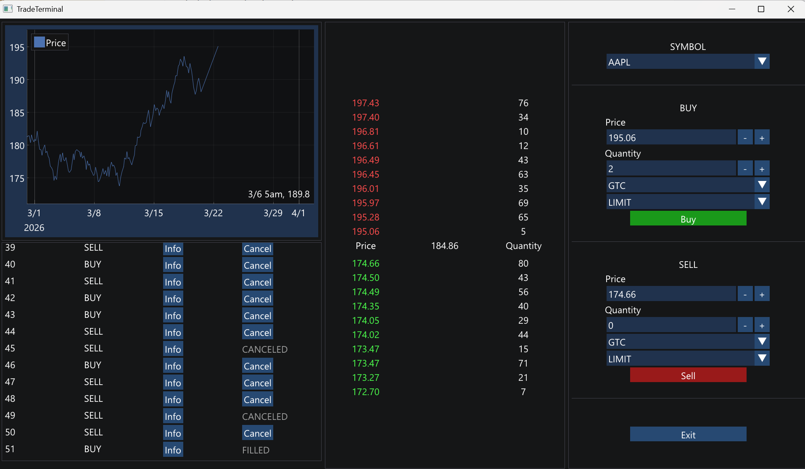

# Limit Order Book

> A limit order book in C++20 that I built to learn how exchanges and trading systems are put together, and how to make them fast. It uses a 4-level bitmap to find the best price, keeps the hot path free of heap allocations, and gives every symbol its own matching thread behind a lock-free queue.



**In numbers:** a limit add takes 53 ns (p50) / 71 ns (p99), a cancel 49 / 127 ns, and one thread handles **27.7M operations per second**. Removing heap allocations from the book made it 2.35× faster ([details](#single-threaded-latency-order-book-hot-path)).

---

## What is a Limit Order Book?

A **Limit Order Book (LOB)** is the core data structure of every financial exchange. It maintains two sorted collections of orders:

- **Bids** — buy orders, sorted by price descending (highest price has priority)
- **Asks** — sell orders, sorted by price ascending (lowest price has priority)

When a new order arrives, the matching engine checks whether it can be filled against the opposite side. If a buy price ≥ the best ask, a trade executes. Otherwise, the order rests in the book waiting for a counterpart.

---

## Architecture

```
UI / ClientSimulator / TcpServer
        │
        ▼
CoreEngine::CreateOrder(...)
        │
        ▼
OrderRouter::Route(request)
        │
        ▼
LockFreeQueue<OrderPod, N>
        │
        ▼
SymbolWorker::Run()
        │
        ▼
MatchingEngine<StorageType>
        │
        ▼
BinaryOrderBook | MultisetOrderBook
```

Every symbol gets its own memory pool, queue, order book and worker thread, so symbols never wait on each other.

### Core Components

```
include/
├── Concurrency/
│   ├── ClientSimulator.h
│   ├── LockFreeQueue.h
│   ├── OrderQueue.h
│   ├── SymbolWorker.h
│   └── Worker.h
├── Domain/
│   ├── order.h
│   ├── OrderPod.h
│   ├── OrderRequest.h
│   ├── Time.h
│   ├── trade.h
│   ├── TradeHistory.h
│   └── TradePod.h
├── Engine/
│   ├── CoreEngine.h
│   └── MatchingEngine.h
├── Memory/
│   ├── IdIndexMap.h
│   └── OrderPool.h
├── Networking/
│   ├── Protocol.h
│   └── TcpServer.h
├── Routing/
│   └── OrderRouter.h
├── Storage/
│   ├── BinaryOrderBookStorage.h
│   ├── IOrderBookStorage.h
│   └── MultisetOrderBookStorage.h
└── UI/
    ├── GraphPanel.h
    ├── OrderBookPanel.h
    ├── OrderEntryPanel.h
    ├── OrdersPanel.h
    └── TradeTerminal.h

src/
├── Concurrency/
│   ├── ClientSimulator.cpp
│   ├── OrderQueue.cpp
│   ├── SymbolWorker.cpp
│   └── Worker.cpp
├── Domain/
│   └── order.cpp
├── Engine/
│   └── CoreEngine.cpp
├── Memory/
│   └── OrderPool.cpp
├── Networking/
│   ├── Protocol.cpp
│   ├── TcpServer.cpp
│   └── TestServer.cpp
├── Routing/
│   └── OrderRouter.cpp
├── Storage/
│   ├── BinaryOrderBookStorage.cpp
│   └── MultisetOrderBookStorage.cpp
└── UI/
    ├── GraphPanel.cpp
    ├── OrderBookPanel.cpp
    ├── OrderEntryPanel.cpp
    ├── OrdersPanel.cpp
    └── TradeTerminal.cpp

Tests/
├── benchmarks/
│   ├── LatencyBench.cpp
│   ├── MultithreadedBenchmark.cpp
│   └── OrderBookBenchmarkv2.cpp
├── Concurrency/
│   ├── TestConcurrency.cpp
│   ├── TestLockFreeQueue.cpp
│   └── TestWorker.cpp
├── Domain/
│   └── test_order.cpp
├── Engine/
│   ├── TestCoreEngine.cpp
│   └── TestMatchingEngine.cpp
├── Memory/
│   ├── TestIdIndexMap.cpp
│   └── TestOrderPool.cpp
├── Networking/
│   ├── TestProtocol.cpp
│   └── TestTcpServer.cpp
├── Routing/
│   └── TestOrderRouter.cpp
├── Storage/
│   ├── test_binaryorderbook.cpp
│   └── test_multiset_storage.cpp
├── FullTest.cpp
└── TestEndToEnd.cpp

scripts/
└── python_client.py

main.cpp
```

### Threading Model

- **One worker thread per symbol.** It takes new orders from that symbol's queue and runs the matching.
- **A lock-free queue per symbol.** Anything that sends orders (the UI, TCP clients, the simulators) can push at the same time without blocking each other. When the queue is empty, the worker spins and calls `yield`.
- **A lock per symbol** (`std::shared_mutex`). The worker holds it while it processes an order, so the UI can safely read the book. Cancels also take it, from the thread that sends them. This lock is the main thing I want to remove next (see [Known Limitations](#known-limitations-and-next-steps)).
- **One registry lock**, only used when a new symbol is created.

### Why a Bitmap Index

Every price has one bit, and the bits are grouped in 4 levels (`312,501 × 4,884 × 77 × 2` 64-bit words). To find the best bid, I look for the highest set bit on each level with `__builtin_clzll`. That is always 4 steps, no matter how many orders are in the book, so it is O(1). I also kept a `std::multiset` version of the book, to compare the two (see [Bitmap vs Multiset](#bitmap-vs-multiset)).

### No Heap Allocations on the Hot Path

At each price, orders wait in a FIFO queue, and any order can be cancelled by its id. In the first version, both of these allocated memory: every order got a list node created with `new`, plus an entry in a `std::unordered_map`. Now neither allocates:

- **The list lives inside the pool.** Each order's slot in the pool stores the `Next` and `Prev` links of its price queue, as pool indices. Adding, cancelling or matching an order only touches memory the pool already has, and the order and its links sit in the same cache line.
- **A paged id → slot table** (`IdIndexMap`) replaces the hash map. A lookup is a shift, a mask and two reads, with no hashing. Ids are grouped in pages of 4,096, a page is created the first time it is needed, and it is reused once all its orders are gone. So the memory follows the orders that are still alive (about 2 MB for 50K resting orders), not every id ever used.

With these, every main operation is O(1): **add** (append to the list, set a bit), **cancel** (find the slot, unlink it, clear the bit if the price is now empty) and **best price** (4 bit scans). The only allocations left happen once, when a new range of prices or ids is used for the first time, and that is already done during warm-up.

---

## Benchmarks

### Single-threaded latency: order book hot path

`latency_bench` calls the matching engine and the book directly, on one thread, with no queues, workers or locks in between. Every operation is timed on its own.

Intel Core i5-12400F, WSL2 (Ubuntu 24.04), GCC 13.3 `-O3 -DNDEBUG`, thread pinned to one core. 10M measured operations; median of 5 runs (by throughput).

| Operation | p50 | p90 | p99 | p99.9 | p99.99 |
|---|---|---|---|---|---|
| Limit add | 53 ns | 60 ns | 71 ns | 124 ns | 661 ns |
| Cancel | 49 ns | 63 ns | 127 ns | 287 ns | 2.3 µs |
| Market order (matching) | 88 ns | 149 ns | 180 ns | 258 ns | 7.7 µs |

**Throughput:** 27.75M operations/s (36 ns/op), measured in a separate run without timing each operation.

#### Before / after removing heap allocations

I tagged the version before this change as `baseline`, so both versions can be built and run with the same benchmark, on the same machine, with the same seed:

| | Before | After | Change |
|---|---|---|---|
| Throughput | 11.83M ops/s | 27.75M ops/s | **2.35×** |
| Add p99 | 170 ns | 71 ns | 2.4× |
| Add p99.99 | 8.3 µs | 661 ns | 12.5× |
| Cancel p50 | 122 ns | 49 ns | 2.5× |
| Cancel p99 | 251 ns | 127 ns | 2.0× |
| Market p99 | 360 ns | 180 ns | 2.0× |

The biggest difference is in the slowest operations: before, a call to the allocator sometimes took several microseconds. To make sure I didn't break anything, I checked that both versions produce exactly the same 1,128,729 trades on the same 10M operations.

#### Same test on an Apple M2

I also ran it on my MacBook (Apple M2, macOS, Apple Clang 15 `-O3`), median of 5 runs:

| | Before | After | Change |
|---|---|---|---|
| Throughput | 11.28M ops/s | 37.68M ops/s | **3.3×** |
| Add p99.99 | 12.3 µs | 1.1 µs | 11× |
| Cancel p99 | 583 ns | 83 ns | 7× |
| Cancel p99.99 | 19.5 µs | 375 ns | 52× |
| Market p99.99 | 14.0 µs | 1.2 µs | 12× |

#### How I measured

- **Workload:** I fill the book with 50K orders, run 500K warm-up operations that are not recorded, then measure 10M operations: 45% limit orders that rest in the book, 45% cancels and 10% market orders.
- **Prices:** most orders are placed 0 to 3 ticks away from the middle price, like on a real market (geometric distribution, p = 0.3, at most 499 ticks away). Limit orders never cross the spread, so all matching comes from market orders.
- **Same input every time:** the seed is fixed (42) and all operations are generated before the timer starts, so the random number generator is never measured.
- **What is timed:** for adds and market orders, taking a slot from the pool, filling it in and `ProcessOrder`; for cancels, `CancelOrder`.
- **The clock itself:** I use `std::chrono::steady_clock`. Reading it twice in a row takes about 16 ns, and that is **included** in the numbers above, so the real cost of each operation is a bit lower.
- **Left out:** cancels for orders that a market order had already filled (3.5% of cancels), because they only test the "order not found" case. I also don't report the maximum: on a virtual machine, one random spike usually comes from the host, not from my code.

#### Reproducing

```bash
git worktree add ../lob-baseline baseline        # the "before" version
for d in LimitOrderBook-v2 lob-baseline; do
  (cd ../$d && g++ -std=c++20 -O3 -DNDEBUG -Iinclude \
     ../LimitOrderBook-v2/Tests/benchmarks/LatencyBench.cpp \
     src/Storage/BinaryOrderBookStorage.cpp src/Memory/OrderPool.cpp src/Domain/order.cpp \
     -o ../bench-$d)
done
../bench-lob-baseline 2          # argument = CPU to pin to
../bench-LimitOrderBook-v2 2
```

### Whole system (end-to-end)

These tests go through everything: queues, worker threads and the lock. So they can't be compared with the single-thread numbers above.

#### Sustained Load Test (75 seconds)

`FullTest` runs 8 symbols with one thread sending orders for each: 75% market orders and 25% limit orders within ±5% of the middle price. It also cancels orders all the time, so each book stays at about 2,000 resting orders. Median of 3 runs on each machine:

| | Intel i5-12400F (WSL2, GCC 13.3) | Apple M2 (macOS, Apple Clang 15) |
|---|---|---|
| Orders processed/sec | **5,324,800** | **1,955,440** |
| Matches/sec | 4,599,939 | 1,689,187 |
| Volume/sec | 25,959,301 | 9,533,026 |
| Cancels/sec | 623,664 | 228,410 |
| Dropped (queue full) | 0 | 0 |
| Rejected (pool full) | 0 | 0 |
| Run-to-run spread | 5.07M – 5.64M | 1.94M – 1.97M |

I count the orders the workers actually **processed**, not the ones that were sent, and before stopping the clock I wait until every order is either processed, dropped or rejected. Nothing was dropped, which means the workers kept up with the senders. So the real limit of the engine is probably higher, and the test is limited by how fast the 8 sender threads can create orders. Memory stays flat for the whole run.

Why is the Mac slower here when it was faster on one thread (37.7M vs 27.8M ops/s)? This test keeps 16 threads busy (8 senders and 8 workers). The i5 can run 12 threads at once on 6 fast cores, but the M2 only has 8 cores and 4 of them are efficiency cores, so the threads have to share them.

#### Round-Trip Latency

`BM_OrderRoundTripLatency` (Google Benchmark): one thread sends an order and waits until it has been matched, 20,000 times. There is always enough liquidity, so every order matches right away. i5-12400F, WSL2, median of 5 repetitions:

| p50 | p90 | p99 | p99.9 |
|---|---|---|---|
| 0.99 µs | 5.3 µs | 8.0 µs | 37 µs |

### Bitmap vs Multiset

Both books have the same interface, so the matching engine can run on either one. Google Benchmark, one thread, i5-12400F, WSL2, GCC 13.3 `-O3`, median of 5 repetitions. Times are **ns per operation** (lower is better), for books with 1K to 90K resting orders:

| Operation | Storage | 1K | 4K | 32K | 90K |
|---|---|---|---|---|---|
| `AddOrder` | Multiset | 97 | 109 | 133 | 176 |
| | **Bitmap** | **54** | **55** | **56** | **60** |
| Resting-order pipeline | Multiset | 109 | 108 | 125 | 160 |
| | **Bitmap** | **54** | **56** | **57** | **59** |
| `CanFillQuantity` | **Multiset** | **15.2** | **15.1** | 15.3 | 16.0 |
| | Bitmap | 23.3 | 17.1 | **13.6** | **13.9** |
| `GetBestBid` | **Multiset** | **0.6** | **0.6** | **0.6** | **0.6** |
| | Bitmap | 4.3 | 4.1 | 4.0 | 4.0 |

Matching orders right away (with an empty book): Multiset 65 ns, Bitmap 69 ns.

What I take from this:

- **Adding orders: the bitmap is 1.8 to 2.9× faster, and its time doesn't grow with the book.** It stays at 54–60 ns from 1K to 90K orders. The multiset gets slower as the book grows, because it is a tree (O(log n)) and it allocates a node for every order.
- **Best price: the multiset wins, but it doesn't matter much.** `std::multiset` already keeps a pointer to its first element (0.6 ns), while the bitmap does four bit scans (4 ns). Both are tiny compared to an add or a cancel.
- **`CanFillQuantity` depends on the book size.** The multiset is faster on small books, the bitmap on big ones (32K and up).
- **Immediate matching is almost a tie (multiset about 5% faster).** I looked into why: for every fill, my bitmap book walks the bitmap several times (`IsAskEmpty`, `GetBestAsk` twice, then `PopBestAsk`). Remembering the best price would avoid that, and it is on my list.

I use the bitmap book by default, because in practice most of the work is adding and cancelling orders near the best price.

---


**Dependencies** — CMake ≥ 3.20, C++20, Google Benchmark, Google Test, ImGui, ImPlot. **Platforms** — Linux, macOS.
